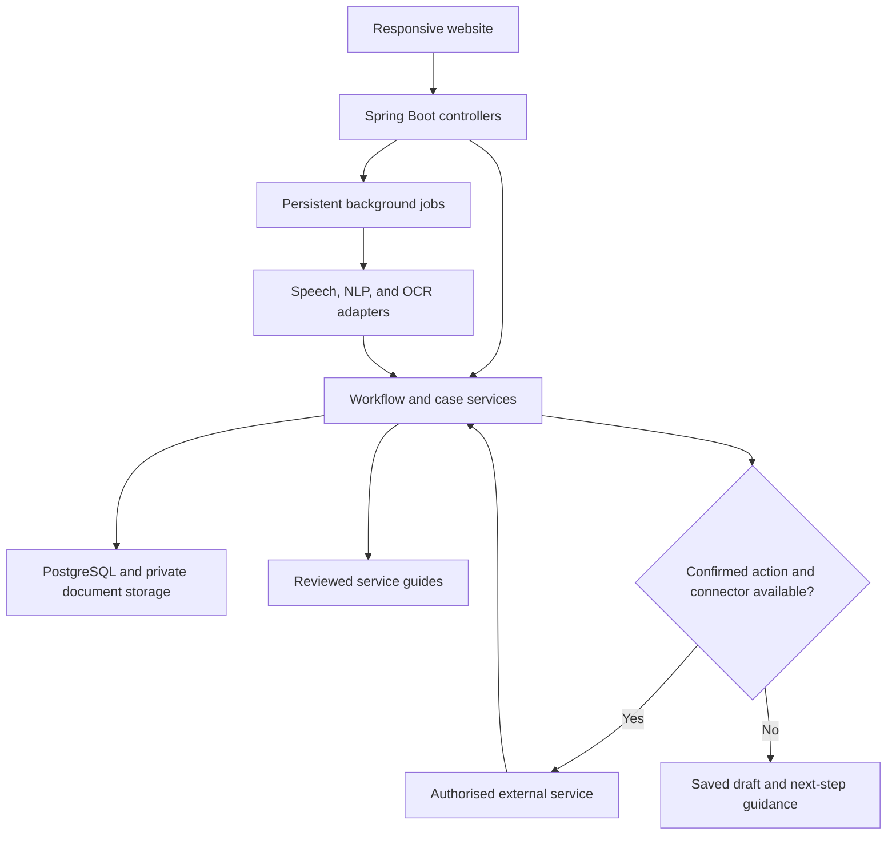

# Shohoj Sheba — সহজ সেবা

**A proposed Bangla voice-assisted citizen service portal built with Java and Spring Boot.**

Speak your need, understand the process, prepare your information, and follow your service request through one accessible website.

> **Project status:** Planning and design. This README describes the intended implementation; it does not claim that the features, integrations, or deployment already exist. No government affiliation or integration is established by this document. The working project name can be changed.

##  Languages and technology stack

The initial application will use one modular Spring Boot backend and a responsive, server-rendered frontend. It is a software-only project and uses the microphone and camera already available on users' devices.

| Layer | Proposed technology | Purpose |
| --- | --- | --- |
| Backend language | Java | Domain models, business logic, workflows, concurrency, and integrations |
| Backend framework | Spring Boot with Spring MVC | Web pages, HTTP endpoints, dependency injection, and application configuration |
| Frontend structure | HTML5 and Thymeleaf | Accessible pages and server-rendered forms |
| Frontend styling | CSS3 and Bootstrap | Responsive layouts, large controls, and consistent visual design |
| Frontend interaction | JavaScript | Microphone recording, audio playback, uploads, progress updates, and asynchronous requests |
| Database language | SQL | Relational data definition and queries |
| Database | PostgreSQL | Accounts, service definitions, drafts, consent records, and job state |
| Persistence | Spring Data JPA | Repository access and entity persistence |
| Authentication | Spring Security | Login, permissions, and protected sessions |
| Build tool | Maven and Maven Wrapper | Dependency management, builds, and tests |
| Database migrations | Flyway | Versioned database changes |
| Speech recognition | Bangla-capable provider behind a Java interface | Convert recorded speech to text |
| Language understanding | NLP/LLM integration behind a Java interface | Classify requests and explain retrieved instructions |
| Speech synthesis | Bangla-capable text-to-speech provider | Speak questions and explanations |
| Document extraction | OCR provider or library | Extract candidate text from uploaded images |
| Background execution | Spring task executors and Java concurrency utilities | Process independent work outside the request thread |
| Testing | JUnit, Mockito, and integration tests | Verify workflows, permissions, concurrency, and integration behaviour |
| Document storage | Private file/object storage | Keep uploaded files separate from public website assets |

Exact dependency versions will be pinned in the build when implementation begins. Speech, NLP, and OCR providers remain to be selected after Bangla accuracy, cost, privacy, and latency evaluation.

### Frontend approach

Thymeleaf renders the main pages. JavaScript progressively adds voice recording, audio playback, and background progress checks. Users can still use buttons and forms if voice services fail or microphone permission is denied.

React is not required for the initial version. A separate mobile client can later use the same backend APIs. An installable progressive web app is a later milestone, not an existing capability. Sensitive documents must not be placed in an offline browser cache by default.

Browser microphone access requires user permission and a secure context in production. The website records speech after an explicit user action; it does not listen continuously in the background.

##  Abstract

Shohoj Sheba is a proposed software platform designed to improve access to citizen services for people with limited literacy, limited digital experience, or difficulty understanding formal administrative language. The platform aims to bring guidance for passport applications, birth and death registration, visa preparation, land and property services, transport and municipal services, finance and public benefits, and citizen helplines into one responsive website. Its primary interaction method is spoken Bangla, supported by clear pictures, large buttons, short instructions, and conventional forms.

The system will combine speech recognition, natural language processing, structured service workflows, reviewed official information, and text-to-speech output. A citizen can describe a need in ordinary language, answer one question at a time, prepare a document checklist, confirm extracted information, save a draft, and resume the task later. The assistant will use approved source material to explain procedures and will ask for clarification when an utterance or document cannot be understood reliably. Names, dates, identifiers, and other consequential details will require user confirmation before use.

Java and Spring Boot will provide the application backend, while HTML, CSS, JavaScript, Thymeleaf, and Bootstrap will provide the frontend. PostgreSQL will store structured records. Object-oriented design will separate citizen sessions, service definitions, workflow steps, application drafts, documents, and integration adapters. Controlled multithreading will support independent operations such as audio processing, document extraction, voice generation, reminders, and source monitoring while preserving the correct order of each citizen's workflow.

The long-term goal is a single interface for preparing and following service requests, with direct transactions added wherever supported and authorised integrations are available. Official submission, approval, document issuance, and required physical checks remain dependent on the responsible authorities. The project will be evaluated through task-completion studies, Bangla voice accuracy, accessibility testing, data-isolation tests, and recovery from processing failures. Its intended contribution is a practical way for citizens to understand and complete the next correct step with less dependence on complex written interfaces.

##  Problem statement and objectives

A person may know what they need but not know the department name, the required terminology, or how to navigate a form. A conventional directory of links still leaves that person to interpret the process independently.

This project will aim to:

- Let citizens describe their needs in spoken Bangla.
- Translate reviewed instructions into short, understandable steps.
- Organise services by user goals as well as departments.
- Help users prepare information without guessing missing facts.
- Keep progress across interrupted sessions.
- Distinguish a local service request from an official application.
- Support administrators who maintain accurate service information.
- Demonstrate Java OOP, database design, and meaningful concurrent processing.

##  Intended users and roles

| Role | Intended capabilities |
| --- | --- |
| Visitor | Browse public guides and verified helplines without an account |
| Citizen | Create private drafts, upload documents, confirm answers, and manage reminders |
| Assistance officer | Help with specifically assigned cases after the citizen grants access |
| Content editor | Propose changes to service guides and source references |
| Content reviewer | Approve, publish, supersede, or withdraw service guide versions |
| Administrator | Manage roles, service configuration, operational issues, and audit access |

Access to a role does not automatically grant access to every citizen's identity documents. Permissions must be checked on each protected record.

##  Planned service coverage

| Category | Proposed assistance | External dependency |
| --- | --- | --- |
| Passport | Process explanation, checklist, draft preparation, reminders | Submission and live status require a supported official connection |
| Birth and death registration | Service selection, information collection, document preparation | Official recording and decisions belong to the responsible authority |
| Visa | Destination-specific and visa-type-specific guidance | Requirements and decisions depend on the relevant destination authority |
| Land and property | Explain terms, identify relevant services, organise records | Official records, transactions, and legal determinations are external |
| Transport and civic logistics | Licensing, vehicle, and municipal service guidance | Each service needs its own source and integration assessment |
| Finance and public benefits | Explain sourced procedures, payment steps, and application preparation | Financial transactions and eligibility decisions require the relevant provider |
| Emergency and citizen helplines | Reviewed contact directory with direct call controls | Calling a number does not confirm emergency dispatch |

Coverage will be introduced gradually. This README does not provide current government requirements, fees, or deadlines.

##  How the system works

### Citizen journey

1. **Start:** The citizen chooses a picture or presses the microphone button.
2. **Capture:** The browser records the request after permission is granted.
3. **Understand:** Speech recognition returns text; NLP identifies a possible service and relevant details.
4. **Clarify:** If the request is ambiguous, the assistant asks a short follow-up question.
5. **Select a workflow:** The backend loads the appropriate published service guide and workflow version.
6. **Collect information:** The assistant asks one question at a time and saves confirmed responses.
7. **Prepare documents:** The citizen follows a checklist and optionally uploads documents for extraction.
8. **Review:** The assistant reads information back; the citizen can correct or remove it.
9. **Choose the next action:** The system prepares a draft, opens an official channel, or uses an available authorised connector after confirmation.
10. **Follow progress:** The dashboard explains the actual state and offers relevant reminders.

### Example conversation

> **Citizen:** “আমি পাসপোর্টের আবেদন করতে চাই।”
>
> **Assistant:** “আপনি কি নতুন আবেদন করতে চান, নাকি আগের পাসপোর্টের জন্য সেবা চান?”
>
> **Citizen:** “নতুন আবেদন।”
>
> **Assistant:** “আমি ধাপে ধাপে সাহায্য করব। কোনো কথা বুঝতে না পারলে ‘আবার বলুন’ বলতে পারেন।”

This example illustrates interaction design. Actual questions must be derived from the reviewed workflow for the selected service.

### Proposed architecture

##  Voice and NLP design

| Stage | Responsibility | Failure handling |
| --- | --- | --- |
| Speech-to-text | Produce a transcript from Bangla audio | Ask for repetition or allow manual entry |
| Intent classification | Suggest the service the citizen needs | Offer two or three spoken choices |
| Entity extraction | Suggest values such as dates or locations | Read values back before saving them as confirmed |
| Workflow validation | Check required fields and permitted transitions | Explain the missing or invalid information |
| Knowledge retrieval | Fetch relevant passages from reviewed guides | Stop unsupported answers and offer assistance |
| Response generation | Explain retrieved content in simple Bangla | Preserve numbers, conditions, and source meaning |
| Text-to-speech | Speak the approved response | Display the same text and offer replay |

The workflow engine controls which actions are permitted. Model-generated text must not directly trigger submission, payment, deletion, or a change of official status.

Regional accents will be evaluated with speakers from the intended pilot area. Support for every dialect is not assumed. Users can say phrases such as “আবার বলুন”, “ধীরে বলুন”, “আগের ধাপে যান”, and “বাতিল করুন”. Important actions require explicit confirmation; silence is not consent.

##  Core modules

### Service catalogue and knowledge management

Each guide records its source URL, issuing organisation, applicable location, last review date, reviewer, publication status, and version. Editors propose changes; reviewers approve publication. Automated change detection creates a review task rather than silently rewriting public guidance.

An in-progress draft retains its guide version. If a material update affects that draft, the citizen is informed and the affected steps are reviewed before proceeding.

### Application drafts and service requests

A draft contains user-confirmed information. A service request is a local case in this platform. Neither is an official submission by itself.

Proposed local case states:

| State | Meaning |
| --- | --- |
| `DRAFT` | Information is being collected |
| `NEEDS_INFORMATION` | A required answer or document is missing |
| `READY_FOR_REVIEW` | The draft is ready for confirmation |
| `USER_CONFIRMED` | The citizen has confirmed the prepared information |
| `SUBMISSION_PENDING` | A supported connector is attempting submission |
| `SUBMITTED` | An official acknowledgement has been received |
| `SUBMISSION_UNKNOWN` | A timeout occurred and the external outcome must be reconciled |
| `ACTION_REQUIRED` | A verified response requires another action |
| `COMPLETED` | Completion is supported by the relevant response or record |
| `CANCELLED` | The local request was cancelled where allowed |

Official approval or rejection is recorded separately from local processing progress. A job finishing successfully does not mean an application was approved.

### Documents and OCR

Users can upload permitted file types within defined limits. Extraction creates candidate values, not verified facts. The system distinguishes unreadable images, missing fields, and unconfirmed values. It does not claim to authenticate a document merely because OCR succeeds.

### Reminders and helplines

Citizens can opt in to reminders and cancel them. Reminder times use the citizen's timezone, with Asia/Dhaka as the initial product default. Helplines remain accessible without login. Emergency calling is not blocked by a chatbot questionnaire.

### Payments and billing — conditional future module

If payments are introduced, display any platform assistance fee separately from an official fee. Use a supported payment provider, verify provider callbacks, and reconcile uncertain outcomes. Never store card security codes or payment PINs. A payment receipt is distinct from an application acknowledgement and an approval.

##  Multithreading and background processing

Spring provides task execution and scheduling abstractions. The implementation will use configured executors rather than creating an unrestricted new thread for every action.

| Workload | Proposed execution | Correctness requirement |
| --- | --- | --- |
| Speech and voice generation | Dedicated I/O worker pool | Attach results to the correct session turn |
| Document extraction | Limited worker pool | Keep page order and require confirmation |
| Draft rendering | Background job | Render a fixed, confirmed draft version |
| Reminders | Scheduler dispatching persistent jobs | Prevent duplicate delivery |
| Source checks | Independent background jobs | Require review before publication |

Proposed Java mechanisms include `ThreadPoolTaskExecutor`, `CompletableFuture`, `@Async`, and `@Scheduled`. Calls to proxy-based asynchronous services will cross Spring bean boundaries; self-invocation must not be assumed to run asynchronously.

Design requirements:

- Set worker limits, queue limits, timeouts, and explicit rejection handling.
- Sequence steps within one conversation even when different users run concurrently.
- Give each operation a case ID, user ID, turn/version ID, and correlation ID.
- Reject stale results rather than overwriting newer answers.
- Use database transactions and optimistic locking for shared records.
- Use idempotency keys and uniqueness constraints to prevent repeated actions.
- Persist important jobs; an in-memory executor does not survive a restart.
- Reconcile unknown external outcomes before retrying submissions or charges.
- Notify users only after the relevant database transaction commits.
- Coordinate scheduled jobs across application instances to prevent duplicates.

Threading improves responsiveness; it does not make sequential dependencies disappear or guarantee external service availability.

##  Object-oriented design

| Class or interface | Responsibility | OOP concept |
| --- | --- | --- |
| `CitizenSession` | Conversation state and current step | Encapsulation |
| `ServiceDefinition` | Service identity and available workflows | Abstraction |
| `ServiceGuideVersion` | Reviewed source content and publication history | Encapsulation |
| `WorkflowStep` | Question, validation rule, and transition | Composition |
| `ApplicationDraft` | Confirmed answers and review state | Encapsulation |
| `DocumentChecklist` | Required items and completion state | Composition |
| `SpeechRecognizer` | Speech recognition contract | Interface and polymorphism |
| `SpeechSynthesizer` | Audio generation contract | Interface and polymorphism |
| `IntentResolver` | Service classification contract | Abstraction |
| `OfficialServiceConnector` | Supported external submission/status operations | Interface and polymorphism |
| `NotificationSender` | Send an opted-in notification | Strategy pattern |
| `BackgroundJob` | Persistent processing state and attempts | Encapsulation |

A `MockOfficialServiceConnector` can support demonstrations with synthetic data. A production connector must be implemented and approved separately. Mock receipts and statuses must be clearly labelled as demonstrations.

Prefer configurable service definitions and composition over a large inheritance hierarchy with a separate user class for every service.

##  Proposed database entities

| Entity | Important fields |
| --- | --- |
| User | ID, authentication reference, preferred language, status |
| Role assignment | User ID, role, permitted scope |
| Service definition | ID, category, name, availability |
| Guide version | Service ID, version, sources, reviewer, publication state |
| Citizen session | Owner ID, selected workflow, turn number, current step |
| Application draft | Owner ID, guide version, confirmed fields, version number |
| Document | Owner ID, private storage key, type, retention deadline |
| Consent record | Owner ID, purpose, timestamp, revocation state |
| Service request | Draft ID, local status, external reference if available |
| Background job | Type, owner/case reference, status, attempts, next retry |
| Reminder | Owner ID, case ID, scheduled time, timezone, delivery state |
| Audit event | Actor, action, record reference, timestamp, outcome |

Sensitive values and raw documents must not be copied into ordinary application logs.

##  Proposed HTTP API

These endpoints are design examples, not implemented routes.

| Method and route | Purpose |
| --- | --- |
| `GET /api/services` | Browse available services |
| `GET /api/services/{id}/guide` | Retrieve a published guide |
| `POST /api/voice/sessions` | Start a voice session |
| `POST /api/voice/sessions/{id}/turns` | Submit one recorded utterance |
| `GET /api/jobs/{id}` | Retrieve authorised job progress |
| `POST /api/drafts` | Create a private draft |
| `PATCH /api/drafts/{id}` | Update confirmed fields with version checking |
| `POST /api/drafts/{id}/documents` | Upload a private document |
| `POST /api/drafts/{id}/confirm` | Confirm the reviewed draft |
| `POST /api/drafts/{id}/submit` | Submit only through an enabled connector |
| `GET /api/requests/{id}` | View the actual case state |
| `POST /api/reminders` | Create an opted-in reminder |
| `GET /api/helplines` | Retrieve reviewed public contacts |
| `POST /api/admin/guides/{id}/publish` | Publish a reviewed version with appropriate permission |

Protected endpoints check record ownership as well as login. Cookie-authenticated write requests require CSRF protection. Long-running operations return a job reference instead of holding a connection open indefinitely.

##  Accessibility and privacy

- Use large touch targets, readable Bangla fonts, and high contrast.
- Pair pictures with text and spoken labels; icons alone can be ambiguous.
- Ask one question at a time and provide repeat, back, correction, and cancel controls.
- Offer keyboard, screen-reader, and manual-input alternatives.
- Allow audio to be stopped immediately and avoid speaking sensitive details unexpectedly.
- Explain microphone use, uploads, storage, and external processing in simple Bangla.
- Keep public guidance available without demanding an identity-document upload.
- Restrict assistance-officer access to authorised cases and log access events.
- Protect transport with HTTPS and private stored documents with encryption and access controls.
- Define retention, deletion, backup expiry, and account-recovery processes.
- Do not use uploaded identity documents to train models without a separate justified and explicit arrangement.
- Treat uploaded text and retrieved content as data, never as instructions that override application permissions.

##  Proposed repository organisation

| Path | Intended contents |
| --- | --- |
| `src/main/java/.../identity/` | Accounts, roles, consent, and permissions |
| `src/main/java/.../catalog/` | Services and reviewed guide versions |
| `src/main/java/.../workflow/` | Sessions, drafts, and state transitions |
| `src/main/java/.../voice/` | Speech adapters and turn handling |
| `src/main/java/.../documents/` | Uploads, extraction, and storage adapters |
| `src/main/java/.../integration/` | Mock and authorised external connectors |
| `src/main/java/.../jobs/` | Executors, persistent jobs, and reminders |
| `src/main/resources/templates/` | Thymeleaf pages |
| `src/main/resources/static/` | CSS, JavaScript, and public images |
| `src/main/resources/db/migration/` | Database migration scripts |
| `src/test/` | Automated tests and synthetic fixtures |
| `docs/` | Architecture decisions and integration notes |

Private uploads do not belong under `static/` or in Git.

##  Implementation and setup plan

There is no verified runnable repository supplied with this README. Installation commands, dependency versions, and environment keys must be documented against the implemented project before release.

Initial implementation steps:

1. Create a Maven Spring Boot project with MVC, Thymeleaf, Security, Validation, and Data JPA.
2. Add PostgreSQL configuration and database migrations.
3. Implement one service workflow using synthetic data and a mock connector.
4. Add the citizen interface and content-review dashboard.
5. Connect and evaluate Bangla speech input and output.
6. Add document extraction, confirmed drafts, and persistent background jobs.
7. Complete privacy, accessibility, and failure-recovery tests.
8. Configure HTTPS, production secrets, backups, monitoring, and retention.

Secrets will be supplied through environment configuration or a secret manager. Real credentials, citizens' documents, recordings, and database exports must never be committed.

##  Testing and evaluation plan

| Area | Acceptance evidence to collect |
| --- | --- |
| Workflow correctness | Required fields and invalid transitions tested |
| Voice usability | Completion rate and correction count with intended Bangla speakers |
| Accessibility | Users can repeat, correct, resume, and complete a pilot task |
| Knowledge quality | Answers trace to approved, current guide versions |
| Privacy | One account cannot retrieve another account's documents or jobs |
| Concurrent updates | Two updates cannot silently overwrite confirmed information |
| Duplicate requests | Repeated requests do not duplicate submissions or payments |
| Recovery | Restarted jobs resume safely; uncertain external results are reconciled |
| External failures | Provider outage gives a truthful state and usable next action |
| Performance | Measured response latency, queue depth, and failure rate under a defined load |

Start with a small usability pilot involving people with limited literacy and expand based on observed problems. No accuracy, scale, or performance results are claimed yet.

##  Roadmap

- [ ] Define and verify the first service workflows.
- [ ] Build responsive Bangla pages and manual navigation.
- [ ] Add private drafts, authentication, and role permissions.
- [ ] Add Bangla voice input, clarification, and audio output.
- [ ] Add reviewed guide publication and version history.
- [ ] Add document extraction and spoken confirmation.
- [ ] Add persistent jobs, reminders, and recovery handling.
- [ ] Run a usability pilot and fix accessibility problems.
- [ ] Assess authorised integration options service by service.
- [ ] Add supported live transactions with reconciliation.
- [ ] Expand service coverage and evaluate regional speech.
- [ ] Consider an installable web app and institutional plans.

##  Commercial direction and boundaries

Potential models include subscriptions for assistance organisations or service centres and clearly disclosed charges for optional human assistance. These are hypotheses requiring customer validation. Basic guidance and emergency contact access should remain easy to reach.

Government fees, platform fees, and third-party fees must be distinguished. The platform must not imply that payment guarantees official approval. It must not claim government affiliation, universal dialect support, perfect accuracy, or nationwide service coverage without evidence.

##  Contribution and licence

Development contributions should include a description of the problem, the proposed change, and relevant tests. Changes to service requirements need authoritative sources and content review. Use synthetic personal data in examples and tests.

**Licence:** Not selected yet. The repository owner should add an appropriate `LICENSE` file before granting public reuse rights. Publishing a repository does not by itself grant an open-source licence.

##  Technical references

- [Spring Framework: Task Execution and Scheduling](https://docs.spring.io/spring-framework/reference/integration/scheduling.html)
- [Spring Boot: Task Execution and Scheduling](https://docs.spring.io/spring-boot/reference/features/task-execution-and-scheduling.html)
- [MDN: Browser Microphone Access with getUserMedia](https://developer.mozilla.org/en-US/docs/Web/API/MediaDevices/getUserMedia)

Official service sources will be added to each guide during service-specific research and review. Technical references do not establish government integration availability.
